# Pipeline Dashboard — telco-revenue-assurance-agent

> Last updated: 2026-10-26 21:19:41

`██████████░░░░░░░░░░░░░░` 43% (3/7 steps)

## 🔀 Pipeline Flow

```mermaid
flowchart LR
    A["rh-qs-discovery"] --> B["rh-qs-architect"] --> C["rh-qs-scaffold"] --> D["rh-qs-implement"] --> E["rh-qs-deploy"] --> F["rh-qs-debug-and-deploy"] --> G["rh-qs-document"]
    style A fill:#d4a017,color:#fff,stroke:#b8860b
    style B fill:#2ea44f,color:#fff,stroke:#1a7f37
    style C fill:#e0e0e0,color:#333,stroke:#bbb
    style D fill:#2ea44f,color:#fff,stroke:#1a7f37
    style E fill:#e0e0e0,color:#333,stroke:#bbb
    style F fill:#e0e0e0,color:#333,stroke:#bbb
    style G fill:#e0e0e0,color:#333,stroke:#bbb
```



## 📋 Pipeline Steps

| # | Step | Status | Output | Completed |
|---|------|--------|--------|-----------|
| 1 | rh-qs-discovery | ⚠️ done | [prd.md](../prds/prd.md) (Output not found! Verify outputs manually) | 2026-09-17T13:55:52 |
| 2 | rh-qs-architect | ✅ done | [architecture-spec.yaml](../designs/architecture-spec.yaml) | 2026-09-23T13:23:40 |
| 3 | rh-qs-scaffold | ⏳ pending | — | — |
| 4 | rh-qs-implement | ✅ done | [implementation-manifest.yaml](../pipeline/implementation-manifest.yaml) | 2026-10-26T15:37:30 |
| 5 | rh-qs-deploy | ⏳ pending | — | — |
| 6 | rh-qs-debug-and-deploy | ⏳ in_progress | — | — |
| 7 | rh-qs-document | ⏳ pending | — | — |

---

## ⚠️ Review Before Continuing — rh-qs-implement

- implementation-manifest.yaml exists in [.rhoai-qs/telco-revenue-assurance-agent/.qs-factory/pipeline/implementation-manifest.yaml](../pipeline/implementation-manifest.yaml)
- make lint && make test pass with zero failures
- Review content: all endpoints implemented, no placeholders, no hardcoded secrets
- Recommend getting a peer engineer review on the implementation before continuing

---

## ▶️ Next Step

**rh-qs-deploy** — Deploy configuration — wires ai-architecture-charts Helm subcharts, compose.yml for local dev, Containerfiles, and Makefile deploy targets

```
/rh-qs-deploy qs-name=telco-revenue-assurance-agent
```
