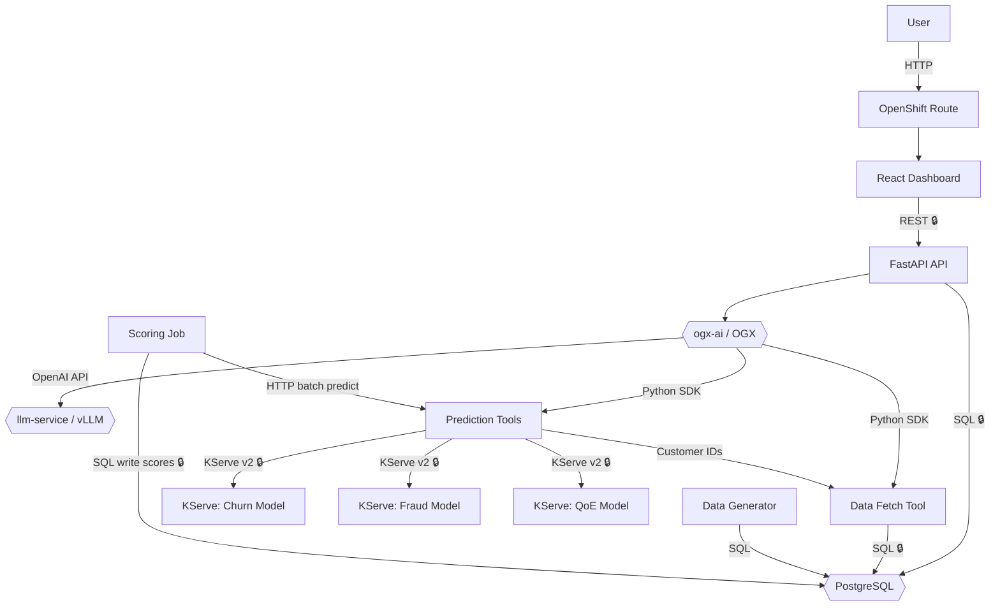
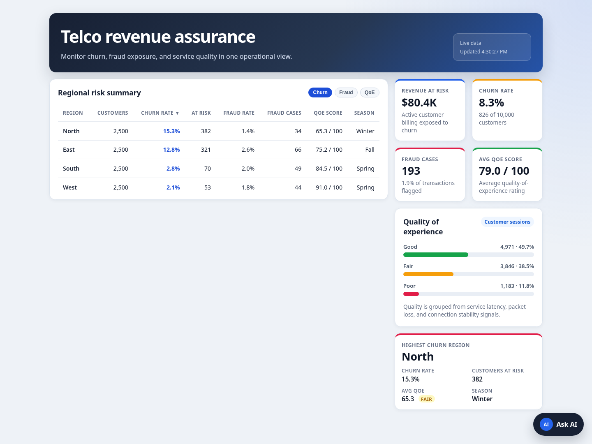
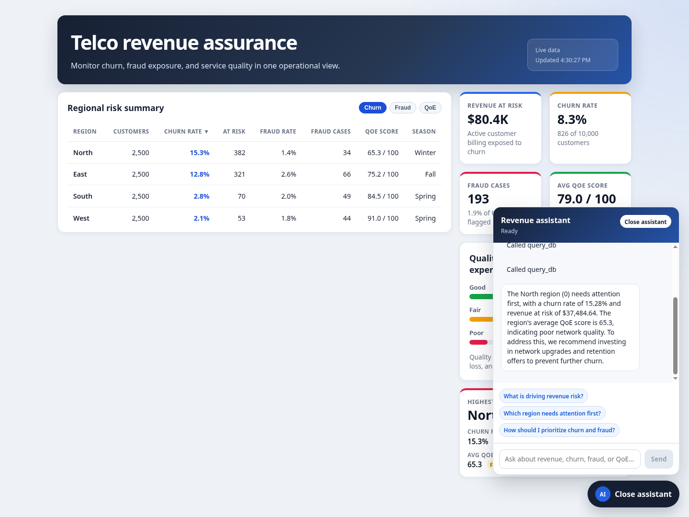

# Detect Telco Revenue Losses with an AI Agent

Detect churn risk, billing fraud, and network QoE issues using a conversational AI agent backed by three ML models on OpenShift® AI.

## Table of Contents

- [Description](#description)
- [Architecture](#architecture)
- [Usage](#usage)
- [Example Queries](#example-queries)
- [Requirements](#requirements)
- [Deploy](#deploy)
- [Delete](#delete)
- [Troubleshooting](#troubleshooting)
- [Reference](#reference)
- [Tags](#tags)

## Description

This AI quickstart shows how a telecom revenue assurance team can use a conversational AI agent to investigate customer churn risk, billing fraud, and network Quality of Experience (QoE) across customer segments in real time. Rather than running manual SQL queries or switching between dashboards, an analyst asks the agent in plain language and receives model-backed insights in seconds — with the agent deciding autonomously which tools and models to call.

The agent runs on Red Hat® OpenShift AI using OGX with a Llama 3.1 8B Instruct model served by vLLM. It uses a ReAct loop to decide when to query the customer database, when to invoke the churn or fraud prediction models, and when to fetch QoE metrics — combining SQL data retrieval with live ML inference to produce actionable analyst guidance. All three prediction models (churn, fraud/RAFM, and QoE) are served as KServe InferenceServices on Red Hat OpenShift AI, using LightGBM and ONNX runtimes.

A React dashboard gives analysts a high-level regional risk summary and surfaces the same AI agent through a floating chat panel. A FastAPI backend orchestrates communication between the UI, the OGX agent, and a PostgreSQL database populated by a one-off data generator job using synthetic but statistically realistic telco customer, transaction, and network data.

At deployment, a scoring job pre-computes churn, fraud, and QoE predictions for all customers and writes them to the database. The dashboard reads these stored scores to display summary metrics — churn rate, fraud count, and average QoE by region — without hitting the models at runtime. The agent operates on-demand, filtering, slicing, and cross-referencing the same model APIs to answer analyst follow-up questions in real time.

## Architecture



| Component | Role |
|---|---|
| **React Dashboard** | Regional risk metrics + floating AI chat interface |
| **FastAPI Backend** | REST API — routes chat and metrics requests |
| **ogx-ai / OGX** | Agent orchestration and ReAct tool loop |
| **vLLM** | Llama 3.1 8B Instruct on-cluster inference |
| **Data Fetch Tool** | Queries PostgreSQL for customer and transaction data |
| **Prediction Tools** | Wraps KServe Churn, Fraud, and QoE model endpoints |
| **PostgreSQL** | Customer, transaction, and regional QoE data store |
| **Data Generator** | One-off job that populates the database with synthetic telco data |
| **Scoring Job** | One-off batch job that runs churn, fraud, and QoE predictions for all customers and writes scores back to PostgreSQL |
| **KServe Models** | LightGBM (churn), ONNX (fraud/RAFM), ONNX (QoE) |

**Agent tools** called by the ReAct loop:

| Tool | Category | Purpose |
|---|---|---|
| `query_db` | Data | Grouped customer query with churn/fraud/region filters |
| `count_customers` | Data | Count customers matching a single condition |
| `cross_metric_count` | Data | Count customers matching two cross-metric conditions |
| `list_customers` | Data | List individual customers with filters |
| `fetch_customer_data` | Data | Full profile for a specific customer |
| `fetch_transaction_data` | Data | Transaction records for a specific customer |
| `predict_churn` | Prediction | Churn risk score via KServe |
| `predict_fraud` | Prediction | Fraud flag via KServe |
| `predict_qoe` | Prediction | QoE score via KServe |

### S4 object storage

[S4 (Super Simple Storage Service)](https://github.com/rh-aiservices-bu/s4) provides the project's S3-compatible object storage. The deployment installs the `aws-compatible-storage` Helm release from `deploy/helm/aws-compatible-storage/`, using the S4 container image `quay.io/rh-aiservices-bu/s4:0.3.2`. Its default data volume is 80 GiB, and a bucket-bootstrap Job creates `mybucket`.

The application uses S4 through the S3 API:

- **Dataset uploads:** `demo/scripts/upload_datasets.py` uploads the three training datasets under `data/`. It runs locally and connects through the `aws-compatible-storage-api` OpenShift route.
- **Pipeline artifacts:** DSPA connects to the internal S4 service using `dashboard-dspa-secret`. Training writes model artifacts under `models/churn/1/`, `models/fraud/1/`, and `models/starlink-qoe/1/`.
- **Model serving:** KServe uses the endpoint, bucket, and credentials in the `my-data-connection` secret to retrieve the trained models.
- **QoE preprocessing:** the predictor loads `scaler.joblib` and `label_encoders.joblib` from `models/starlink-qoe/artifacts/`. The deployment sets its artifact endpoint from the same `S3_*` settings and supplies credentials from `my-data-connection`.

Customer records, transactions, and prediction scores remain in PostgreSQL. S4 holds the datasets and artifacts used to train and serve the models.

## Usage

After completing the [deployment steps](#deploy), including data generation and scoring, find the dashboard endpoint with the OpenShift CLI. Use your configured `NAMESPACE`, or fall back to the current OpenShift project, and list its routes:

```bash
NAMESPACE="${NAMESPACE:-$(oc project -q)}"
oc get routes -n "$NAMESPACE"
```

Set `NAMESPACE` to your application's project if needed. Select the dashboard route from the list (`frontend` by default), then print its URL:

```bash
ROUTE_NAME=frontend  # Replace with your dashboard route name.
oc get route "$ROUTE_NAME" -n "$NAMESPACE" -o jsonpath='https://{.spec.host}{"\n"}'
```

Open the printed URL in your browser to explore the app.

The screenshots below show the deployed app with synthetic data. Metrics and the highest-risk region depend on the dataset and stored predictions; the figures in [Example Queries](#example-queries) are illustrative.

### 1. Review the revenue assurance overview

Start with the summary cards to understand the current exposure:

- **Revenue at risk** shows customer billing exposed to churn.
- **Churn rate** shows the percentage and count of customers predicted to churn.
- **Fraud cases** shows the flagged count and percentage of transactions.
- **Avg QoE score** summarizes quality of experience on a 0–100 scale, where higher scores indicate better service quality.

The **Quality of experience** panel breaks customer sessions into Good, Fair, and Poor groups. The **Highest churn region** card highlights the region to investigate, including its churn rate, customers at risk, average QoE, and season.



*Dashboard overview with pre-computed predictions for 10,000 synthetic customers.*

### 2. Compare regional risks

Use the buttons above **Regional risk summary** to change the table's sort order:

- **Churn** places the highest churn rate first (the default view).
- **Fraud** places the highest fraud rate first.
- **QoE** places the lowest quality score first, surfacing regions with the weakest service quality.

Compare customer counts, churn exposure, fraud rates, and QoE across the same rows to choose a follow-up question. In the captured snapshot, North has the highest churn rate and lowest QoE, while East has the highest fraud rate. This gives the analyst separate starting points for network-quality and billing investigations.

### 3. Investigate with the AI assistant

1. Select **Ask AI** in the bottom-right corner to open the **Revenue assistant** panel.
2. Choose a suggested question, such as **Which region needs attention first?**, to fill the question field, or type your own question.
3. Select **Send**. The assistant displays **Thinking…** while it investigates and shows tool activity, such as **Called query_db**, alongside the conversation.
4. Read the response, then ask follow-up questions in the same panel to narrow the investigation. Select **Close assistant** to return to the unobstructed dashboard.



*A completed response to “Which region needs attention first?” using the deployed dataset.*

Try follow-ups such as:

- “Why is churn high in North?” — substitute the region highlighted in your dashboard.
- “Are fraud-flagged customers also churning?”
- “Which customers in North are at risk of churning?”

Use the findings to decide which coverage, retention, or billing investigation to pursue. The agent recommends actions; it does not apply retention offers or block accounts. Dashboard metrics come from stored scoring results, while the assistant can query the data and invoke prediction tools on demand.

## Example Queries

The agent reasons across all three models in a single conversation. Below are representative examples using the synthetic dataset included in this quickstart.

### "Why is churn so high in the West?"

The agent queries the database to segment customers by region, runs churn predictions per segment, and finds Region West at 35% churn versus 12% average elsewhere — 870 customers at risk. It then checks QoE for that region (34/100 vs 72 average) and fraud rate (0.5%, same as other regions). Response:

> *"Churn is concentrated in Region West — 35% of customers there are predicted to churn vs 12% average elsewhere. Starlink QoE in that region is 34/100, significantly below the 72 average. Poor satellite coverage correlates with the high churn rate. Fraud rate is normal (~0.5%), so billing issues are not a factor. 870 customers are at risk — consider investigating network coverage or targeting them with retention offers."*

### "Are fraud-flagged customers also churning?"

The agent fetches the fraud-flagged customer list, runs churn predictions on each, and cross-references the results:

> *"66% of fraud-flagged customers are also at churn risk. These may be billing disputes rather than actual fraud — review before blocking accounts."*

### "Which region needs attention first?"

The agent scores QoE across all regions, finds the worst performer, then checks churn and fraud for those customers to build a revenue-at-risk ranking:

> *"Region West is the clear priority: QoE of 34/100 and 35% churn (870 of 2,500 customers), versus 12% churn elsewhere. Only 8 of those 870 also have fraud-flagged transactions, so billing anomalies are not compounding the problem. Poor satellite coverage is the root cause."*

## Requirements

### Hardware

| Node Type | Qty | vCPU | Memory |
|---|---|---|---|
| Control Plane | 3 | 8 | 16 GB |
| Worker | 2 | 16 | 32 GB |
| GPU Worker (optional) | 1 | 16 | 64 GB + 1× NVIDIA A10 / A100 / L40S |

> **GPU note:** A GPU node is required when `deploy-all` hosts the LLM on-cluster. To use an existing OpenAI-compatible endpoint instead, set `LLM_URL`; the deployment then skips local LLM provisioning.

### Software

| Software | Tested version |
|---|---|
| Red Hat OpenShift Container Platform | 4.22 (stable-4.22) |
| Red Hat OpenShift AI | 3.4.2 |
| Kubeflow Pipelines | 2.16.0 |
| KServe | 0.17.0 |
| Helm | 3.14+ |
| `oc` CLI | 4.22 |

### Permissions

| Resource group | Required role |
|---|---|
| Helm charts (`pgvector`, `ogx-ai`, tools, frontend) | Namespace admin |
| KServe manifests (`deploy/serving/`) | Namespace admin + OpenShift AI project member |

### Prerequisites

Before running `deploy-all`, ensure the following are in place:

- **CLI tools and login** — `make`, `helm`, `oc`, `envsubst`, `curl`, and Python 3.12 with virtual-environment support are installed, and `oc whoami` returns your cluster username. The deployment creates `.venv` and installs the dataset-upload and KFP dependencies there.
- **Container images** — application and pipeline-base images must be available. For in-cluster builds, enable the OpenShift internal registry and use `make deploy-namespace` followed by `make build-all`. Alternatively, configure `IMAGE_REGISTRY` for published project images.
- **Persistent storage** — set `STORAGE_CLASS` to a storage class available on your cluster (`oc get storageclass` lists them). It is required for the S4 data volume and the DSPA database. `deploy-all` provisions S4 and its default bucket; datasets and trained models are prepared during deployment.
- **LLM access** — either configure a running endpoint with `LLM_URL`, or provide a GPU node and export an `HF_TOKEN` with access to the [Llama model](https://huggingface.co/meta-llama/Llama-3.1-8B-Instruct) for local deployment. The default `LLM_MODEL_NAME` is `meta-llama/Llama-3.1-8B-Instruct`; set it to the model served by your endpoint when using another supported model.

## Deploy

### Configure the deployment

Use the S4-enabled application checkout containing `Makefile`, `deploy/Makefile`, and `deploy/helm/aws-compatible-storage/`. From the repository root, configure the namespace, storage class, credentials, and LLM endpoint:

```bash
export NAMESPACE=telco-revenue-assurance-agent
export STORAGE_CLASS="<your-storage-class>"
export PGVECTOR_PASSWORD="<your-database-password>"
export S3_ACCESS_KEY="<your-s4-access-key>"
export S3_SECRET_KEY="<your-s4-secret-key>"
export LLM_URL="https://<your-vllm-host>/v1"
```

These S3 credentials configure both S4 and its clients. Export `LLM_API_TOKEN` if the remote endpoint requires authentication. To deploy the LLM on-cluster, leave `LLM_URL` unset and export `HF_TOKEN` instead; `deploy-all` provisions the model and waits for it to become ready.

S4 defaults to the application namespace (`S4_NAMESPACE=$NAMESPACE`). In-cluster clients use `http://aws-compatible-storage.${S4_NAMESPACE}.svc:7480`, with `S3_HOST`, `S3_PORT`, and `S3_SCHEME` supplying those values. The default bucket is `mybucket`. The local dataset uploader discovers the HTTPS `aws-compatible-storage-api` route; override `S3_EXTERNAL_ENDPOINT` if that route differs in your environment. Port 7480 serves the S3 API; port 5000 serves the web UI.

For a separate storage namespace, create it first and export `S4_NAMESPACE` before deploying. If changing `S3_BUCKET`, also update `buckets.names` in `deploy/helm/aws-compatible-storage/values.yaml` so the bootstrap Job creates that bucket. The DSPA template derives its storage hostname from `S4_NAMESPACE`; overriding `S3_HOST` alone does not redirect DSPA to an external object store.

### Deploy the application

From the repository root, run:

```bash
make deploy-all NAMESPACE="$NAMESPACE"
```

In a Makefile recipe, the equivalent invocation is `make deploy-all NAMESPACE=$(NAMESPACE)`. Use the shell form above when running the command in a terminal.

The root target performs the deployment in phases:

1. Create the namespace and secrets, install S4 and PostgreSQL, and generate customer data (unless `PGVECTOR_IMAGE` supplies a pre-seeded database).
2. Upload training datasets to S4, then deploy DSPA.
3. Run the churn, fraud, and QoE training pipelines and wait for successful runs to write their artifacts to S4.
4. Provision the local LLM if `LLM_URL` is unset, then deploy KServe resources, data-fetch, predictor, OGX, backend, scoring, and frontend.

The target includes storage and application readiness checks and waits for scoring to complete. Container images must already be built or published. Run serially, with no parallel `-j` setting in the command or `MAKEFLAGS`, so the prerequisite targets execute in order.

### Verify and open the dashboard

Check that services and models become ready and the scoring job completes:

```bash
oc get pods,inferenceservices,jobs -n "$NAMESPACE"
oc logs job/scoring -n "$NAMESPACE"
```

Print the dashboard URL:

```bash
oc get route frontend -n "$NAMESPACE" -o jsonpath='https://{.spec.host}{"\n"}'
```

Open the URL and follow the [usage walkthrough](#usage). If scoring has completed but metrics are missing, see [Scoring job completes but dashboard shows no metrics](#scoring-job-completes-but-dashboard-shows-no-metrics).

## Delete

The root `undeploy-all` target removes the application, S4, and the local LLM, and deletes **all PVCs in `$NAMESPACE`**. This removes persisted database and S4 data in the default configuration; the namespace itself is retained.

```bash
make undeploy-all NAMESPACE="$NAMESPACE"
```

## Troubleshooting

### OGX / OGX agent returns "Internal server error"

The model ID configured in the backend does not match what OGX registered. Verify the available models:

```bash
oc exec -n $NAMESPACE deploy/ogx-ai -- \
  curl -s http://localhost:8321/v1/models | python3 -m json.tool
```

The model ID must match the backend chart's `ogx.modelId`, which deployment sets from `OGX_MODEL_ID`. For the default model, it is `llama-3-1-8b-instruct/meta-llama/Llama-3.1-8B-Instruct`. Check that `LLM_MODEL_NAME` and `LLM_URL` match the model served by your endpoint.

---

### KServe InferenceServices stuck in `Unknown` or `Loading`

This is expected until the ML training pipelines have written model files to S4. Check the model-serving status:

```bash
oc get inferenceservice -n $NAMESPACE
```

If pipelines have completed and models are still not ready, check that the `my-data-connection` secret points to the correct S4 S3 API endpoint and bucket.

---

### Pipeline base image build fails

Ensure the OCP internal registry is enabled and the `pipeline-base` BuildConfig was applied:

```bash
oc get buildconfig pipeline-base -n $NAMESPACE
oc logs bc/pipeline-base -n $NAMESPACE
```

---

### S4 connection or bucket errors from DSPA or pipelines

Check the S4 deployment, its S3 service, and the bucket-bootstrap Job in the storage namespace:

```bash
S4_NAMESPACE="${S4_NAMESPACE:-$NAMESPACE}"
oc rollout status deployment/aws-compatible-storage -n "$S4_NAMESPACE" --timeout=120s
oc get service aws-compatible-storage -n "$S4_NAMESPACE"
oc logs job/aws-compatible-storage-bucket-bootstrap -n "$S4_NAMESPACE"
```

The service should expose the S3 API on port 7480, and the bootstrap logs should confirm `Verified: mybucket` (or your configured bucket). If the volume is pending, check the PVC and `STORAGE_CLASS`. If storage is ready but a client fails, check its endpoint and bucket configuration and ensure `dashboard-dspa-secret` and `my-data-connection` use the S4 credentials configured at deployment.

For local dataset-upload failures, retrieve the S3 API route:

```bash
oc get route aws-compatible-storage-api -n "$S4_NAMESPACE" -o jsonpath='https://{.spec.host}{"\n"}'
```

The uploader must be able to reach this URL from your workstation. Use `S3_EXTERNAL_ENDPOINT` to override route discovery; the web UI route is not an S3 API endpoint.

---

### Scoring job completes but dashboard shows no metrics

The backend caches metrics at startup. Restart the backend pod after the scoring job completes:

```bash
oc rollout restart deployment/backend -n $NAMESPACE
```

## Reference

| Resource | Description |
|---|---|
| [Data Generator](data-generator/README.md) | Synthetic data generation parameters and seeding options |
| [Prediction Tools](tools/predictor/README.md) | Prediction service configuration, model URLs, and TLS setup |
| [KFP Pipelines](demo/pipelines/) | Kubeflow Pipeline definitions for model training |

## Tags

- **Industry:** Telecommunications
- **Product:** Red Hat OpenShift AI
- **Use case:** Revenue assurance, churn prediction, fraud detection, network QoE monitoring
